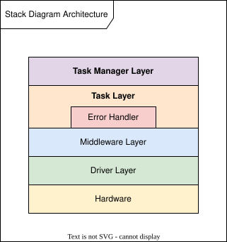

<!-- Please do not change this html logo with link -->

<a target="_blank" href="https://www.microchip.com/" id="top-of-page">
   <picture>
      <source media="(prefers-color-scheme: light)" srcset="images/mchp_logo_light.png" width="350">
      <source media="(prefers-color-scheme: dark)" srcset="images/mchp_logo_dark.png" width="350">
      
   </picture>
</a>

# AVR SD Safety Framework


The AVR® SD family of microcontrollers, including the AVR32SD20, AVR32SD28 and AVR32SD32, integrates a large set of hardware safety mechanisms that monitor the CPU, memories, clocks, power supply and program execution. These mechanisms are closely interconnected through a central Error Controller and must be configured, diagnosed and serviced correctly throughout the device lifecycle to work as one safety system.

The AVR SD Safety Framework is the functional safety software that coordinates these mechanisms through a controlled software lifecycle. From the first instructions after reset, it initializes and diagnoses the safety system, schedules latent fault diagnostics alongside the application under watchdog supervision, centralizes software and hardware error handling and manages Safe State transitions and reset recovery. It also provides the execution flow for the application, so development starts from a working safety system and can focus on the application-specific functionality.

The framework is ISO 26262 ASIL C and IEC 61508 SIL 2 compliant and is developed under Microchip's TÜV Rheinland-certified functional safety management system. For IEC 60730 appliance controls, the AVR SD hardware and the Safety Framework take the place of the Class B libraries available for other Microchip 8-bit MCUs.

[](https://www.microchip.com/myMicrochip/#/request-github-access)
[](https://microchip-pic-avr-solutions.github.io/avr-safety-framework/)
[](https://www.microchipdirect.com/product/AVR-SD-SAFETY-FRAMEWORK)

This repository contains the public API documentation of the framework. The source code, including an MPLAB® X example project for the AVR32SD32 Curiosity Nano, is available free of charge with immediate access through the [source access form](https://www.microchip.com/myMicrochip/#/request-github-access). The [Functional Safety Package](#functional-safety-package) adds the safety, compliance and verification documentation needed to use the framework in a safety application.

## Features

- Safety-system initialization and configuration
- Startup diagnostics with hardware error injection
- Periodic latent fault diagnostics
- Unified Error ID handling for framework, application and hardware errors
- Configurable error criticalities and application callbacks
- Preservation and handling of reset reasons across diagnostic resets
- SWDT-supervised Task durations and WDT-supervised execution flow
- Controlled transition between Safe State and Mission Mode
- Middleware for supported safety-related hardware features
- Task-based application schedules and extension points
- Interrupt handling for supported error sources
- Optional controlled Shutdown into deeper sleep modes

The framework is designed to be extended without modifying its source. Applications configure the framework and extend it with application Tasks, Middleware and Drivers that follow the same architecture, so the framework source and its verification evidence remain unchanged. The framework uses no dynamic memory allocation and contains no third-party code.

## What the Code Looks Like

The framework is written in C99, and the source code prioritizes readability and clarity, with comments that explain the intent of each step. The following functions are copied from the framework source.

`TM_PreStartup` is the first Task Manager that runs after every reset, before `main`:

```c
void TM_PreStartup(void)
{
    // Immediately ensure that the system is in a Safe State after device reset
    T_EnsureSafeState();

    /*
     * Determine and store the reset reason for later handling. This prevents infinite reset loops
     * during reset diagnostics and ensures that the actual reset reason is reported instead
     * of any error injection resets.
     */
    T_DetermineResetReason();

    /*
     * Perform all error injections that should lead to system resets or have side effects that can
     * only be cleared by a reset. The FSM state changes with each system reset until reaching the
     * final state where the function returns normally and the Pre-startup sequence is complete.
     */
    T_RunResetDiagnosticFsm();
}
```

`T_EnsureSafeState` is the Task behind the first call. It verifies that all I/O pins are floated after the reset, forces them into Safe State if they are not and records the fault for Startup. Deviations from MISRA C:2025 are marked in the code and justified in the MISRA C:2025 Compliance Report:

```c
void T_EnsureSafeState(void)
{
    const errFlag_t flag = MW_CheckIoSafe();

    // I/O Pins not floated (tri-Stated)
    const bool isIoUnsafe = (flag != NO_ERROR);
    if (isIoUnsafe)
    {
        MW_EnableForceFloat(); // Force tri-stating of all I/O pins
        MW_StorePersistentFlag(PFLAG_IO_FLOAT_FAULT, isIoUnsafe);
    }
    else
    {
        // Intentional misra-c2025-2.2/14.3 deviation [SF_MISRA-001]
        if (STRICT_SAFE_STATE == ENABLED)
        {
            MW_EnableForceFloat();
        }
    }
}
```

`EH_HandleError` is the central Error Handler. Framework checks, hardware error flags, diagnostic results and application checks all report their errors here with an Error ID, and the criticality configured for that Error ID selects the response:

```c
void EH_HandleError(errFlag_t flag, errId_t id)
{
    const errId_t validId       = DetermineValidErrorId(flag, id);
    const errCrit_t criticality = DetermineErrorIdCriticality(validId);

    switch (criticality)
    {
    case IGNORE:
        // Exit error handler without doing anything
        break;
    case NOTIFICATION:
        // Push to log and handle later
        EH_PushNotificationLog(validId);
        break;
    case NON_CRITICAL:
        // Handle error right away by issuing configured callback
        nonCriticalErrorCallback(validId);
        break;
    case CRITICAL:
        // Intentional fallthrough to handle error as CRITICAL by default
    default:
        EH_InitiateSafeState(validId);
        break;
    }
}
```

The API documentation shows how an application uses the framework, including the application entry point and the example schedules in [Main Example](https://microchip-pic-avr-solutions.github.io/avr-safety-framework/group__main__example.html).

## Architecture

The Safety Framework is implemented with a layered Task-based architecture:



- **Task Manager Layer** contains Task Managers that ensure that the correct Task is called at the correct time.
- **Task Layer** contains Tasks that implement high-level logic, decision-making and error handling.
- **Middleware Layer** contains hardware resource managers that provide services to Tasks.
- **Driver Layer** contains simple Drivers for specific hardware peripherals and modules for register access.

The Task Managers control the device lifecycle. After every reset, Pre-startup verifies that the device is in Safe State and runs the diagnostics that require device resets, while retaining the original reset reason. Startup then initializes the safety system, runs the remaining startup diagnostics and the application Startup schedule and transitions the device from Safe State into Mission Mode. In Mission Mode, the Scheduler runs the application schedule under the supervision of the Synchronous Watchdog Timer (SWDT), which gives every Task a fixed duration, and the Watchdog Timer (WDT), which supervises the complete schedule.

[Software Architecture](https://microchip-pic-avr-solutions.github.io/avr-safety-framework/software_architecture.html) describes the design in detail.

## Development Process

The Safety Framework is developed according to:

- ISO 26262 ASIL C
- IEC 61508 SIL 2
- ASPICE Capability Level 3
- MISRA C:2025 (with C99)

Development follows Microchip's TÜV Rheinland-certified functional safety management system. Independent Microchip functional safety assessors have confirmed compliance with ISO 26262 ASIL C and IEC 61508 SIL 2 through a functional safety audit and assessment at independence level I3, the highest level defined by ISO 26262. An official Automotive SPICE assessment by intacs-certified Microchip assessors has confirmed Capability Level 3 for all assessed processes.

The framework is developed using top-down test-driven development. The unit tests of each component start with functional tests derived from its requirements, supplemented with tests for equivalence classes and boundary values, until every component reaches 100% line, branch and MC/DC code coverage. Static analysis, integration testing on target hardware, fault injection and timing measurements complete the verification.

## Packages

| Content                                       | Public | Source | Functional Safety |
| --------------------------------------------- | :----: | :----: | :---------------: |
| API documentation and UML diagrams            |  Yes   |  Yes   |        Yes        |
| Release Notes, release manifest and checksums |  Yes   |  Yes   |        Yes        |
| Framework source code                         |        |  Yes   |        Yes        |
| MPLAB X example project                       |        |  Yes   |        Yes        |
| Unit test source in the API documentation     |        |        |        Yes        |
| Software Safety Manual                        |        |        |        Yes        |
| Software FMEA and DFA                         |        |        |        Yes        |
| MISRA C:2025 compliance documentation         |        |        |        Yes        |
| Process assessment result summaries           |        |        |        Yes        |
| Test, coverage and static analysis reports    |        |        |        Yes        |

The public documentation is this repository. The Source Package is free of charge through the [source access form](https://www.microchip.com/myMicrochip/#/request-github-access), and the Functional Safety Package is available on [Microchip Direct](https://www.microchipdirect.com/product/AVR-SD-SAFETY-FRAMEWORK).

## Functional Safety Package

The Functional Safety Package (Microchip Direct product AVR-SD-SAFETY-FRAMEWORK) contains the documentation and evidence needed to use the framework in a safety application, in addition to the complete contents of the Source Package. The following sections describe each part in more detail.

### Software Safety Manual

The Software Safety Manual is the central document for safety integration. It documents all implemented Safety Measures together with the Assumptions of Use and responsibilities of the System Integrator. It also documents compliance with the MPLAB® XC Compiler Functional Safety Manual, the AVR SD Family Safety Manual and the applicable ISO 26262 and IEC 61508 requirements.

### Software FMEA and DFA

The Software FMEA analyzes how the framework can fail and how it can be misused. It covers implementation errors, design limitations and random hardware faults, together with the configuration and usage errors that the application can introduce. Each failure mode is traced to its effects, its detection mechanism, the Safety Measures and Assumptions of Use that mitigate it and the contingency actions that limit its effect, and is rated before and after mitigation. Failure modes that create shared dependencies or cascading failures are analyzed further in the Software DFA.

### MISRA C:2025 Compliance

The MISRA C:2025 documentation follows MISRA Compliance:2020. The Compliance Plan defines how every guideline is categorized and enforced, how the analysis tools are configured and validated and the competence, review and CI/CD controls that apply to every change. The Compliance Report records the compliance status of every guideline together with the supporting tool results and justifies each approved deviation with its rationale and a documented risk assessment. With this documentation, the framework can be integrated into a MISRA-compliant application, and its evidence can be referenced directly in the application compliance documentation.

### Process Assessments

The ISO 26262 and IEC 61508 Process Assessment Result Summary and the ASPICE Process Assessment Result Summary document the results of the functional safety audit and assessment at independence level I3 and the Automotive SPICE assessment at Capability Level 3. The full audit and assessment reports can be made available on request.

### Verification Evidence

The unit test source is included in the API documentation, where each test file lists the functional tests, equivalence classes and boundary values it covers. Results for more than 1,400 unit tests, built and run with Ceedling, Unity and CMock, are organized by test file, with links to the corresponding test source. The test results and code coverage reports demonstrate 100% line, branch and MC/DC coverage, confirmed by the MCDC Checker. Every finding reported by Coverity and Cppcheck Premium is recorded either as intentional, with a justification, or as a false positive, and the source code is measured against the HIS Source Code Metrics, with the reasoning for every value outside its reference range documented in the HIS Metrics Statement. Lizard checks every function against strict thresholds for cyclomatic complexity, length and number of parameters, keeping functions small and reviewable, and every value above a threshold is reviewed. Every framework source file compiles without warnings or errors with the MPLAB XC8 compiler at every optimization level, with `-Wall -Wextra -Wundef -pedantic` and warnings treated as errors. The Clang-Tidy and Clang-Format configurations are included for checking application code with the same rules, and the Software Bill of Materials confirms that no third-party components were identified.

A safety application on the AVR SD family also relies on the device-level Safety Manual and FMEDA, available in the AVR SD Device Functional Safety Packages for ISO 26262 and IEC 61508, and on the MPLAB XC Compiler Functional Safety Manual. All three are available on Microchip Direct, and the Release Notes list the links.

## Getting Started

1. Read the [API documentation](https://microchip-pic-avr-solutions.github.io/avr-safety-framework/), starting with the *Home* page and *Software Architecture*.
2. Get the source code free of charge through the [source access form](https://www.microchip.com/myMicrochip/#/request-github-access), and run the included example project on an AVR32SD32 Curiosity Nano.
3. Follow [Getting Started](https://microchip-pic-avr-solutions.github.io/avr-safety-framework/index.html#getting_started) on the *Home* page to configure the framework and add application Tasks.
4. For the application software, [Integrating Application Software](https://microchip-pic-avr-solutions.github.io/avr-safety-framework/software_architecture.html#integrating_application_software) in *Software Architecture* recommends a top-down design using the same layered architecture, illustrated with a simplified electronic fuse application, from the application requirements to its Tasks, Middleware and Drivers.

The supported devices, compiler and Device Family Pack versions and the memory footprint are listed in the Release Notes. Before using the framework in a safety application, read the Software Safety Manual, which defines the Assumptions of Use and the responsibilities of the System Integrator. Also check whether a Known Issues List has been published for the release, and check the silicon errata for the target device.

## License and Support

The Safety Framework is provided under the license in [LICENSE.txt](LICENSE.txt).

Ask questions and share feedback in [Discussions](https://github.com/microchip-pic-avr-solutions/avr-safety-framework/discussions). For questions that involve your own application code or configuration, or problems that may affect the safety of your application, email the Functional Safety Team at pic_avr.functionalsafety@microchip.com. Email keeps your project details out of public Discussions and reaches the team directly, so we can follow up with you and help assess the impact on your application. Include the framework version from the Release Notes.

For pricing and quotes for the Functional Safety Package, contact the Functional Safety Team or your local Microchip sales representative.

## Verifying Release Integrity

`release_content.sha256` lists the SHA-256 checksums of the release files, so you can confirm that they are complete and unmodified. Files that may be edited after publishing, such as this README, are not included. From the repository root:

```
sha256sum -c release_content.sha256      # Linux, WSL or Git Bash
shasum -a 256 -c release_content.sha256  # macOS
```

The included `.gitattributes` keeps LF line endings in Git checkouts, so the files continue to match the checksums.

The release manifest `release_manifest_*.json` records how each release file was generated, including the tools, versions and configurations used. It covers the files of all three packages, so it also shows what the Source Package and the Functional Safety Package contain.
